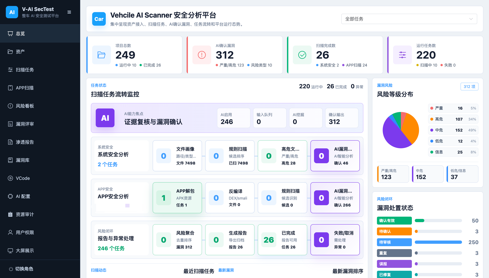
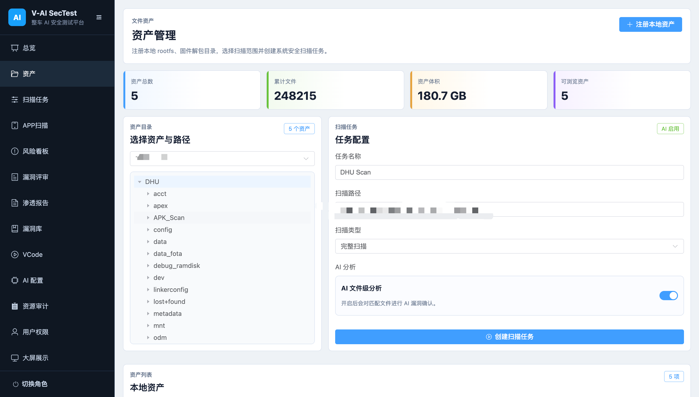
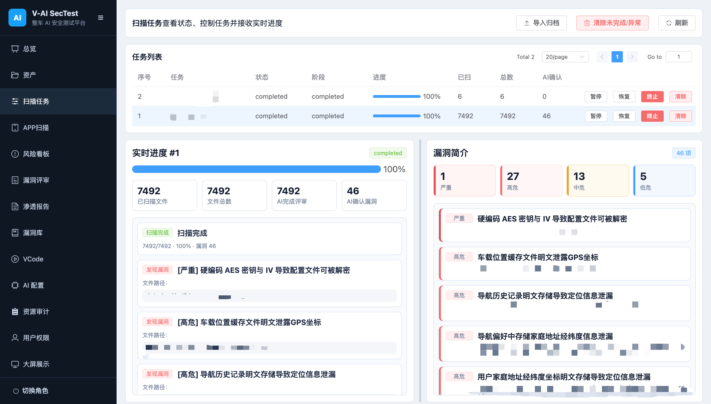
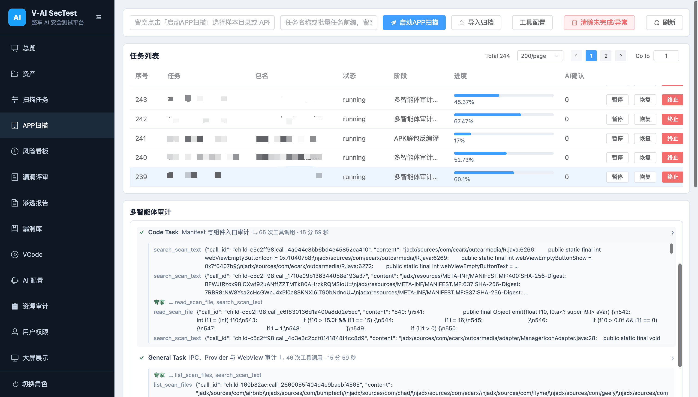
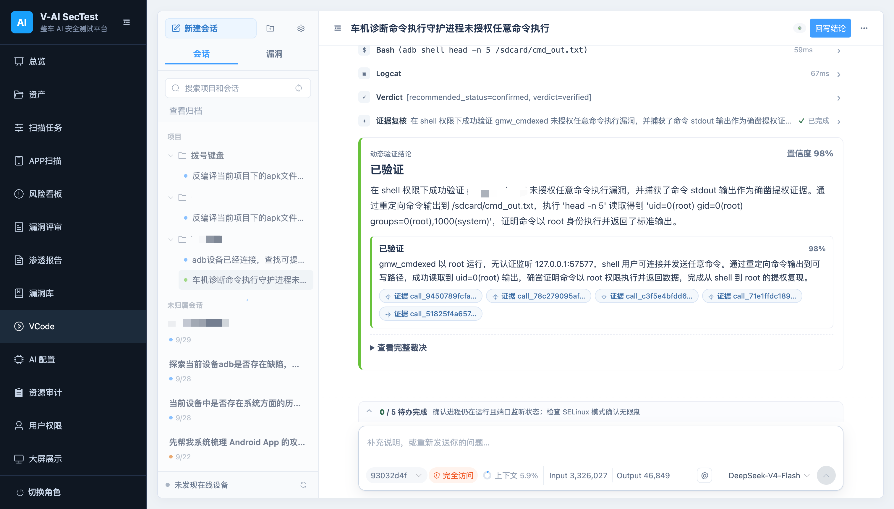
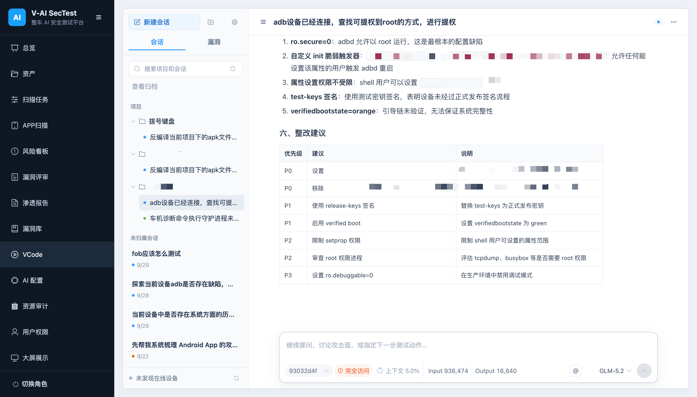

# DeepPen-X

DeepPen-X (Vehicle AI Security Test Platform) is a locally deployed security analysis platform for in-vehicle systems and companion apps. It rebuilds the IoV security boundary around autonomous penetration testing: deterministic analysis maps the attack surface, a multi-Agent team penetrates it autonomously, and an independent evidence adjudicator decides what actually counts as a discovered vulnerability — every conclusion ships with auditable, replayable, SHA-256-anchored evidence.

By default the backend runs on `127.0.0.1:8000`, the frontend on `127.0.0.1:5173`, and the database is a local SQLite file.

This document covers both macOS/Linux and Windows. Unless stated otherwise, all commands run from the project root.

## Screenshots

All screenshots below are taken from a real DeepPen-X runtime.

### Overview



#### Asset Management



### System Security Scan



### APP Scan with File-Level AI Review



### Dynamic Verification Session





## Platform Capabilities

### Three Planes: Recon / Penetration / Adjudication

DeepPen-X enforces a strict division of labor around one principle:

- **Deterministic attack-surface recon (Recon)**: system security scanning, APP scanning, and binary deep analysis jointly model the attack surface of firmware and companion apps. The attack surface is organized by a 23-domain security registry (boot trust chain, credentials, OTA integrity, UDS/DoIP/SOME-IP stacks, platform security, wireless, and more), so no security domain is silently crowded out. Offline rules only nominate candidates; every candidate passes a three-state AI review (`confirmed` / `not_a_vulnerability` / `needs_more_context`) through exploitability gates; each surviving fact is emitted as a penetration hypothesis anchored to the artifact SHA-256 with an explicit `confirm_requires` checklist.
- **Multi-agent autonomous penetration (Penetration)**: dynamic verification is a persistent cycle state machine, not a one-shot model loop. The Planner (no tool permissions) emits immutable, versioned attack plans containing hypotheses, proof obligations, alternative routes, expected observables, and stop conditions. The Executor — the only role holding tools (ADB, SSH, serial, Frida, host commands, workspace files) — carries out the plans, replays credentials, drives diagnostic sessions, exercises IPC surfaces, and explores beyond the plan when the device reveals something new. A single campaign may bind multiple findings and supports composing several isolated medium weaknesses into one high-severity attack chain.
- **Independent evidence adjudication (Adjudication)**: the Evidence Judge rules on every claimed discovery against raw tool results. There are only four routes: `accepted` / `repair_required` (targeted evidence repair) / `replan_required` / `blocked` (manual intervention). By design, `inconclusive` is not an acceptable outcome. Accepted findings are written back to vulnerability management transactionally, with the complete evidence trail (attack plans, ToolRun ledger, Judge rulings) preserved alongside the conclusion for audit and replay.

### Transactional Reliability for 24-Hour Autonomous Operation

The platform treats agent behavior with database-transaction rigor:

- Every attack action is journaled to the ToolRun ledger before execution. Crash recovery proceeds by side-effect class (`read_only` / `idempotent_write` / `non_idempotent_write`); a write interrupted mid-flight is marked `unknown_side_effect` — automatic replay is forbidden and the case escalates to the Judge and human reconciliation.
- Two-layer memory model: authoritative state is regenerated from database events; non-authoritative working memory is progressively compacted at 85%–95% thresholds, with content-addressed blobs preserving raw evidence, verifiable compaction boundaries, a Compactor circuit breaker, and manual Compact/Snip.
- After automatic context compaction, the platform persists a Workspace Resume Checkpoint for the task (file paths, SHA-256, sizes, plan version, latest ToolRun, and the compaction boundary). Continuation writes must pass `workspace_status` comparison, re-reads, and `expected_sha256` checks; text writes use a temp file + `fsync` + atomic rename.
- Supports 24-hour active cycles, automatic device disconnect recovery, approval and tool-transaction recovery, and multi-cycle continuation of the same task.

### Dynamic Verification Sessions (Timeline V2)

Dynamic sessions are served exclusively as Timeline V2: typed nodes render conversations, plans, tools, approvals, evidence reviews, rulings, public status, and errors. Raw diagnostics stay in backend audit data; conversation and process text render as sanitized GitHub Flavored Markdown; failed tools show the real, credential-redacted, length-capped error. Upgrading an existing database requires an idempotent migration plus a read-only check first (see "Dynamic Timeline V2 Deployment Gate" below).

### Multi-Agent Collaboration and Concurrency Scheduling

Scoped vulnerability verification runs as a Planner / Executor / Evidence Judge three-role work-order flow, while free exploration keeps an independent conversation entry. Tasks on the same device are serialized; different devices run in parallel; device-free conversations use a dedicated queue. All roles share process-level and per-user AI concurrency budgets. Agent Teams v2 enables persistent expert queues by default for newly created cycles.

## Repository Layout

Example project root:

```text
fs-sensitive-ai-platform
```

Enter the directory on macOS/Linux:

```bash
cd /path/to/fs-sensitive-ai-platform
```

Enter the directory on Windows PowerShell:

```powershell
cd D:\path\to\fs-sensitive-ai-platform
```

## Requirements

- Python 3.11 or newer
- Node.js 20 or newer
- npm
- APP scanning requires locally executable tools such as `apktool`, `jadx`, and `zip/unzip`; the platform reports missing tools when they are absent
- Dynamic verification and device-side penetration rely on local `adb`, `ssh`, and `sftp`; serial tools and Frida are optional dependencies

## First-Time Setup

### macOS/Linux

```bash
python3 -m venv .venv
source .venv/bin/activate
python -m pip install -r requirements.txt

cd frontend
npm install
cd ..
```

Create `.env.local`:

```bash
cat > .env.local <<'EOF'
APP_SECRET_KEY=change-this-local-secret
FIRST_ADMIN_USERNAME=admin
FIRST_ADMIN_PASSWORD=Admin@Fireware2026!
FS_SAMPLE_ASSET_PATH=/path/to/rootfs-or-sample-dir
LOCAL_AI_API_KEY=replace-with-local-ai-key
EOF
```

Initialize the database:

```bash
source .venv/bin/activate
python scripts/init_db.py
```

### Windows PowerShell

If PowerShell blocks virtual-environment activation, temporarily relax the execution policy in the current window:

```powershell
Set-ExecutionPolicy -Scope Process -ExecutionPolicy Bypass
```

Create the virtual environment and install dependencies:

```powershell
py -3 -m venv .venv
.\.venv\Scripts\Activate.ps1
python -m pip install -r requirements.txt

cd frontend
npm install
cd ..
```

Create `.env.local`:

```powershell
@'
APP_SECRET_KEY=change-this-local-secret
FIRST_ADMIN_USERNAME=admin
FIRST_ADMIN_PASSWORD=Admin@Fireware2026!
FS_SAMPLE_ASSET_PATH=D:\samples\rootfs-or-sample-dir
LOCAL_AI_API_KEY=replace-with-local-ai-key
'@ | Set-Content -Encoding UTF8 .env.local
```

Initialize the database:

```powershell
.\.venv\Scripts\Activate.ps1
python scripts\init_db.py
```

`.env.local` is listed in `.gitignore`; do not commit it.

### Dynamic Timeline V2 Deployment Gate

Dynamic sessions are served exclusively as Timeline V2. When upgrading an existing database, back up the primary database first, then run a one-time idempotent migration followed by a read-only check. If `check` fails, the backend refuses to start — the gate cannot be skipped for deployment:

```bash
.venv/bin/python -m dynamic_verify.timeline_migrate apply
.venv/bin/python -m dynamic_verify.timeline_migrate check
```

On Windows PowerShell:

```powershell
.\.venv\Scripts\python.exe -m dynamic_verify.timeline_migrate apply
.\.venv\Scripts\python.exe -m dynamic_verify.timeline_migrate check
```

The migration runs in per-task independent transactions and is safe to rerun; the original `dynamic_verify_step` audit records are never rewritten. Timeline renders conversations, plans, tools, approvals, evidence reviews, rulings, public status, and errors as typed nodes; raw diagnostics remain only in backend audit data and are never preloaded into session pages. Conversation and process text is rendered uniformly as sanitized GitHub Flavored Markdown; if a provider mistakenly places the DSML tool protocol into a text field, the backend restores it as a real tool call, and historical content is converted to readable Markdown during reprojection. Failed tools display the actual error reason, credential-redacted and length-capped; admin placeholder copy and internal error types never enter the public payload, and transient progress fragments in a failed flow that promise "next steps" without results never enter the public Timeline. Goal contracts, acceptance ledgers, runtime error control, and retry state are backend orchestration data only and never appear in ordinary task responses or pages. The migration check blocks any projection containing such placeholder copy, internal error types, raw DSML, or invalid failed progress from passing the deployment gate. The legacy `/steps`, `/transcript`, and `/ws/dynamic/{task_id}` endpoints are no longer served.

The "full access" (`autonomous`) permission of dynamic verification executes host and device commands directly: `adb_shell` no longer uses a read-only command whitelist and does not reject `getenforce`, `uname`, pipes, command chaining, or device write commands; `host_exec` and `device_exec` likewise bypass command blacklists, target-package checks, and manual approval. Lower permission levels still return approval requests instead of masquerading as command failures. Every ADB shell is recorded serially as a non-idempotent operation, so disconnect recovery never auto-replays commands that may have side effects.

## Foreground Start

Suitable for development and debugging; services stop when the terminals close.

### macOS/Linux

Start the backend:

```bash
source .venv/bin/activate
python -m uvicorn main:app --host 127.0.0.1 --port 8000
```

Start the frontend in a second terminal:

```bash
cd frontend
npm run dev -- --host 127.0.0.1 --port 5173
```

### Windows PowerShell

Start the backend:

```powershell
.\.venv\Scripts\Activate.ps1
python -m uvicorn main:app --host 127.0.0.1 --port 8000
```

Start the frontend in a second PowerShell window:

```powershell
cd frontend
npm run dev -- --host 127.0.0.1 --port 5173
```

Open in a browser:

```text
http://127.0.0.1:5173
```

Backend API documentation:

```text
http://127.0.0.1:8000/docs
```

## Background Start

### macOS/Linux

```bash
mkdir -p logs
nohup .venv/bin/python -m uvicorn main:app --host 127.0.0.1 --port 8000 > logs/backend.log 2>&1 &

cd frontend
mkdir -p ../logs
nohup npm run dev -- --host 127.0.0.1 --port 5173 > ../logs/frontend.log 2>&1 &
cd ..
```

### Windows PowerShell

```powershell
New-Item -ItemType Directory -Force logs | Out-Null

Start-Process -FilePath ".\.venv\Scripts\python.exe" `
  -ArgumentList "-m","uvicorn","main:app","--host","127.0.0.1","--port","8000" `
  -RedirectStandardOutput "logs\backend.log" `
  -RedirectStandardError "logs\backend.err.log" `
  -WindowStyle Hidden

Start-Process -FilePath "npm.cmd" `
  -ArgumentList "run","dev","--","--host","127.0.0.1","--port","5173" `
  -WorkingDirectory ".\frontend" `
  -RedirectStandardOutput "logs\frontend.log" `
  -RedirectStandardError "logs\frontend.err.log" `
  -WindowStyle Hidden
```

## Checking Service Status

### macOS/Linux

```bash
lsof -nP -iTCP:8000 -sTCP:LISTEN
lsof -nP -iTCP:5173 -sTCP:LISTEN
tail -n 80 logs/backend.log
tail -n 80 logs/frontend.log
```

### Windows PowerShell

```powershell
Get-NetTCPConnection -LocalPort 8000 -State Listen | Select-Object LocalAddress,LocalPort,OwningProcess
Get-NetTCPConnection -LocalPort 5173 -State Listen | Select-Object LocalAddress,LocalPort,OwningProcess
Get-Content logs\backend.log -Tail 80
Get-Content logs\frontend.log -Tail 80
```

## Stopping Services

### macOS/Linux

```bash
BACKEND_PID=$(lsof -tiTCP:8000 -sTCP:LISTEN)
[ -n "$BACKEND_PID" ] && kill "$BACKEND_PID"

FRONTEND_PID=$(lsof -tiTCP:5173 -sTCP:LISTEN)
[ -n "$FRONTEND_PID" ] && kill "$FRONTEND_PID"
```

If a process does not exit, replace `kill` with `kill -9`.

### Windows PowerShell

```powershell
$backend = Get-NetTCPConnection -LocalPort 8000 -State Listen -ErrorAction SilentlyContinue
if ($backend) { Stop-Process -Id $backend.OwningProcess -Force }

$frontend = Get-NetTCPConnection -LocalPort 5173 -State Listen -ErrorAction SilentlyContinue
if ($frontend) { Stop-Process -Id $frontend.OwningProcess -Force }
```

## Restarting Services

After updating the code, restart both the frontend and the backend. `uvicorn` here does not enable `--reload`; if port 8000 is still held by an old process, the new frontend will talk to the old backend — typical symptoms are dynamic test sessions failing to load, the Timeline API returning 404, or model configuration submission returning 422. Do not just refresh the browser or restart only the frontend.

### macOS/Linux

```bash
BACKEND_PID=$(lsof -tiTCP:8000 -sTCP:LISTEN)
[ -n "$BACKEND_PID" ] && kill "$BACKEND_PID"

FRONTEND_PID=$(lsof -tiTCP:5173 -sTCP:LISTEN)
[ -n "$FRONTEND_PID" ] && kill "$FRONTEND_PID"

sleep 1
mkdir -p logs
nohup .venv/bin/python -m uvicorn main:app --host 127.0.0.1 --port 8000 > logs/backend.log 2>&1 &

cd frontend
mkdir -p ../logs
nohup npm run dev -- --host 127.0.0.1 --port 5173 > ../logs/frontend.log 2>&1 &
cd ..
```

### Windows PowerShell

```powershell
$backend = Get-NetTCPConnection -LocalPort 8000 -State Listen -ErrorAction SilentlyContinue
if ($backend) { Stop-Process -Id $backend.OwningProcess -Force }

$frontend = Get-NetTCPConnection -LocalPort 5173 -State Listen -ErrorAction SilentlyContinue
if ($frontend) { Stop-Process -Id $frontend.OwningProcess -Force }

Start-Sleep -Seconds 1
New-Item -ItemType Directory -Force logs | Out-Null

Start-Process -FilePath ".\.venv\Scripts\python.exe" `
  -ArgumentList "-m","uvicorn","main:app","--host","127.0.0.1","--port","8000" `
  -RedirectStandardOutput "logs\backend.log" `
  -RedirectStandardError "logs\backend.err.log" `
  -WindowStyle Hidden

Start-Process -FilePath "npm.cmd" `
  -ArgumentList "run","dev","--","--host","127.0.0.1","--port","5173" `
  -WorkingDirectory ".\frontend" `
  -RedirectStandardOutput "logs\frontend.log" `
  -RedirectStandardError "logs\frontend.err.log" `
  -WindowStyle Hidden
```

After restarting, confirm the backend already serves the dynamic session API:

```bash
curl -fsS http://127.0.0.1:8000/openapi.json | python -c "import json,sys; p=json.load(sys.stdin)['paths']; assert '/api/dynamic/tasks/{task_id}/timeline' in p; print('Dynamic Timeline V2 ready')"
```

Windows PowerShell:

```powershell
(Invoke-RestMethod http://127.0.0.1:8000/openapi.json).paths.PSObject.Properties.Name |
  Select-String '/api/dynamic/tasks/\{task_id\}/timeline'
```

## Common Checks

Backend tests:

```bash
pytest -q
```

ELF deep-analysis test suite:

```bash
pytest tests/test_binary_analysis.py -q
```

Frontend build:

```bash
cd frontend
npm run build
```

## Key Paths

- Database: `data/platform.db`
- Archived task databases: `data/tasks/fs-<task_uuid>.db`, `data/tasks/app-<task_uuid>.db`
- Backend log: `logs/backend.log`
- Frontend log: `logs/frontend.log`
- Scan workspace: `workspace/`
- Report output directory: `workspace/reports/`
- Local secret configuration: `.env.local`

Completed system security or APP scans can be archived proactively from the task list. The platform first generates a standalone SQLite database, verifies integrity and row counts, then releases the full evidence, file-level AI results, checkpoints, and bulky audit contexts from the primary database. Tasks and vulnerabilities keep stable UUIDs while existing numeric IDs/APIs remain compatible; the task list, vulnerability review, attack graph, and per-task reports still read archived results transparently. Archive databases contain no user passwords, AI API keys, or data from other tasks, and can be downloaded from the task list as `fs-<task_uuid>.db` or `app-<task_uuid>.db` for separate sharing.

On platform startup and task-list refresh, `data/tasks/` is scanned automatically. Placing an `fs-<task_uuid>.db` or `app-<task_uuid>.db` into that directory registers the task, asset placeholders, vulnerability index, and lightweight AI conclusions into the primary database; if a numeric ID already exists locally, the task/vulnerability IDs are remapped automatically in both the local primary database and the archive. You can also click "Import Archive" on the system scan or APP scan page and choose a shared `.db` file — the platform validates the archive type and SQLite integrity first, then copies it into `data/tasks/` and loads it immediately. Removing the corresponding archive file automatically cleans up the mounted task, vulnerability index, and automatically created archive asset placeholders from the primary database.

Deleting a task also removes its per-task reports in the managed report directory and its archive database. SQLite space reclamation runs in the background when idle; if scans are still running, a pending state is recorded and reclamation continues after the last scan finishes. When backing up the platform, back up both `data/platform.db` and `data/tasks/`.

On Windows, when scanning large or deeply nested APKs, set the `workspace` value in `config/app_config.yaml` to a short path such as `C:\fs_ws` and enable Windows `LongPathsEnabled`. If the backend runs on macOS/Linux, do not use Windows drive-letter paths like `D:\...`; use a mount path accessible to the backend machine, e.g. `/mnt/d/...` under WSL/Linux.

### Cross-Platform Behavior of Dynamic Verification Host Commands

Dynamic verification injects the current host OS, CPU architecture, path separator, default shell, and actually available shells into the Executor context. `host_exec` supports explicitly choosing `auto`, `cmd`, `powershell`, or `posix`:

- On Windows, `auto` stays compatible by using `cmd.exe`; choose `powershell` for complex scripts. The platform launches shells via explicit argv and no longer relies on Python `shell=True` implicit interpretation.
- On macOS/Linux, `auto` uses the POSIX shell. `powershell` may only be selected when `PowerShell/pwsh` is actually discovered on the machine.
- Agents must not mix `ls/grep/sed`, `$VAR`, POSIX single quotes, or `/tmp/...` on Windows, nor use `%VAR%`, `dir/findstr`, or drive-letter paths on macOS/Linux.
- For cross-platform file I/O, prefer `read_file`, `write_file`, `edit_file`, and `list_files`; when a script is truly needed, prefer the discovered Python interpreter and workspace-relative paths.
- Frida launches via argument arrays, so Windows tool or script paths containing spaces no longer go through POSIX quote concatenation.

Use the dynamic device API to inspect the execution environment the backend actually detected:

```text
GET /api/dynamic/devices
```

The `host` field in the response reports `system`, `family`, `machine`, `default_shell`, and `shells`. After a Windows deployment, confirm at least that `cmd` is available; if you need PowerShell dynamic scripts, also confirm that `powershell` appears in `shells`.

### Safe Code/Text Continuation After Auto-Compaction

When the Executor or a free-form session triggers automatic context compaction, the platform creates a persistent Workspace Resume Checkpoint for the current task. The checkpoint records the paths, SHA-256 values, sizes, plan version, latest ToolRun, and compaction boundary of every file touched through `read_file`, `write_file`, or `edit_file` in the current cycle; original steps and workspace files are never replaced by summaries.

Continuation writes after compaction must pass the following gates:

1. `workspace_status` must be called first to compare the checkpoint against the current workspace.
2. Before modifying an existing file recorded in the checkpoint, `read_file` must be called again.
3. `write_file` and `edit_file` must pass the `expected_sha256` from the read result; pass an empty string when creating a new file.
4. A file state mismatch returns `stale_file_state`, requiring a re-read; blind overwrites are forbidden.
5. Text writes use a same-directory temp file, `fsync`, and an atomic rename; an interruption never leaves half of the target file.
6. `host_exec` cannot statically determine its write set, so after compaction all existing files in the checkpoint must be restored before it may run again.

## Valid Vulnerabilities and False-Positive Control

- The platform uses the unified vulnerability scoring standard `unified-risk-scoring-v1`. Offline rules only identify candidate files and evidence, grade file risk, and raise AI review priority; a rule hit can neither confirm a vulnerability nor directly create a `needs_confirmation/open/confirmed` record. A public vulnerability from system security scanning must be output as `confirmed` by the AI file-level review and pass the platform evidence gate before it enters vulnerability briefs, lists, reviews, reports, and dashboards. The final stored `severity` and `risk_score` are computed by the backend's unified scoring function: rule candidates provide the local risk component, and the AI-returned `risk_level` / `risk_score` provide the model component, then the fixed band mapping applies.
- Fixed severity bands: Critical 90-100, High 70-89, Medium 40-69, Low 10-39, Info 0-9. The same task, vulnerability, and evidence must produce the same band and score on repeated scans.
- Base scores are determined by vulnerability type: externally reachable unauthenticated command execution and real private keys embedded in APK/rootfs form the critical baseline; TLS certificate-validation bypass, hardcoded reusable passwords/Tokens/API keys, and high-risk WebView configurations form the high baseline; component exposure, plaintext communication, weak cryptography, sensitive logging, and IoV feature attack surfaces are graded by evidence-chain completeness.
- Bonus points come only from structured evidence: external reachability, missing or invalid authentication, data flow from external input to sensitive operations, impact on vehicle control/diagnostics/OTA/system privileges, and real production credentials or private keys. Model confidence cannot substitute for this evidence.
- Downgrade and capping rules are fixed: ordinary DeepLinks, Binder/IPC, or component entry points not proven to be exported without permission remain attack-surface facts and do not enter formal vulnerabilities; incomplete evidence or unknown production-build status goes to needs-more-context; public certificates, default CAs, example/placeholder values, and debug/demo-only configurations are never promoted to high-risk vulnerabilities. A confirmed exported-component-without-permission finding without a complete exploitation chain is capped at Medium and is no longer pressed down to Info.
- APP scanning first identifies high-risk sensitive features such as AI, voice interaction, debugging/testing, engineering/diagnostics, and privileged vehicle control. For ordinary third-party apps, components with `exported=true`, implicitly exported, and without a declared `permission` (or only a `normal`/`dangerous` custom permission) constitute a confirmable CWE-926 component-exposure/permission-control defect callable by any app; the complete call chain affects grading, not validity. Activity/Receiver findings typically grade Low to Medium, Service/Provider Medium to High, with escalation when external input is shown to reach files, commands, vehicle control, diagnostics, screen recording, credentials, or other sensitive capabilities.
- For platform/vendor system packages (e.g. `com.qualcomm.qti.*`, `com.android.*`, `sharedUserId=android.uid.system`), exported components still follow the platform-permission-model exception: their access is usually protected by platform signature permissions, privileged grants, and SEPolicy, so confirmation from the Manifest alone requires component-code proof that platform-level protection is missing or ineffective.
- `sharedUserId` is IVI app identity context and is not classified as a vulnerability on its own; when another vulnerability is valid, it is only used to assess impact scope.
- System security scanning identifies `user`, `userdebug`, and `eng` builds from property files such as `build.prop`. Only when the build is confirmed as a `user` production build are build-type-related configurations such as ADB/root, `ro.debuggable`, `ro.secure`, SELinux permissive, verity/AVB, and test-keys classified as vulnerabilities. This policy does not exempt independent risks such as hardcoded credentials, private keys, weak TLS, unauthorized interfaces, or command execution.
- System security scanning does not limit the number of AI-reviewed files by default: every enumerated, readable system code, script, configuration, database, log, certificate/key, and ELF structured-evidence item enters AI file-level security analysis. The attack-surface registry serves only as classification, ordering, progress, and attack-graph labels — not as review admission, a vulnerability-type whitelist, or a per-file check cap. `.js/.html/.lua` files are excluded by default under the current measured policy, with counts noted in enumeration events.
- System and APP scans use separate prompts; model conclusions use the three states `confirmed`, `not_a_vulnerability`, and `needs_more_context`, and are re-checked through raw-evidence localization, related files, and deterministic platform policies.
- Each APP main file uses an independent, persistable `review_session_id`. Multi-round analysis of the same file is strictly serial, while different files run concurrently; each round carries the previous round's structured conclusions, the backend merges by stable `finding_id`, and a model omitting findings or returning an empty list never overwrites already-confirmed vulnerabilities with landed evidence.
- Main files are analyzed chunk by chunk with overlap and original line numbers/offsets — never reduced to just the file header when the context overflows. Related files preferentially extract the complete method containing the requested symbol; if the prompt overflows again, the source head and tail, rule/history evidence anchors, and the historical finding ledger are preserved, with the full uncompressed state stored in the APP checkpoint.
- At the end of each round, conclusions, complete evidence fields, round history, completed source chunks, and related artifact hashes are persisted. A service restart or outer retry resumes the same session; if the main file or any related file hash changes, the old session is invalidated and re-analyzed. `error` checkpoints remain retryable, and only `completed` files with matching hashes are skipped at breakpoints.
- Related-file resolution may only access the `jadx`, `apktool`, and `unzip` roots of the current APP task, rejecting model-supplied absolute paths; every final AI evidence item binds a real `artifact_id`, relative path, SHA-256, and original line number, so related-class evidence is never misattributed to the main file.
- APP scanning no longer performs pre-scan LLM agent planning; after unpacking and static candidacy, it proceeds directly to file-by-file code analysis. File analysis shares the process-level global AI concurrency cap; the per-task worker is only a second-level limit. A single scan reuses a connection pool, and timeouts or cancellations wait for in-flight calls to finish cleaning up, avoiding amplified connection and rate-limit failures under multi-task concurrency.
- New dedicated candidate rules cover Bluetooth/Wi-Fi/UDS/DoIP diagnostics, credentials/keys, and Native/JNI; these rules only locate high-risk contexts — complete source evidence, related files, and AI three-state conclusions are still required for the final vulnerability report.
- Login, engineering-mode, factory-mode, and diagnostic entry points are deterministically checked for fixed-password direct comparison, fixed-password hash comparison, and fallback authentication branches after PKI/dynamic-key failure; explicit `has_vulnerability=true` conclusions in the legacy model format still enter the raw-evidence localization flow and are no longer discarded for lacking per-item `decision` fields.
- Protocol names such as HTTPS/MQTT/UDS/DoIP/OTA, public URLs, public certificates, and API names are context candidates only and cannot enter the vulnerability report on their own.

## Binary Deep Analysis

- System security scanning performs structured static analysis on ELF files instead of mere string extraction. The analysis covers: ELF headers/sections/segments, dynamic tables, imported/exported symbols, relocation and PLT resolution, function-boundary recovery, disassembly of dangerous-API call sites, argument backtracking, address-attributed string and code cross-references, and hardening posture (RELRO/NX/PIE/canary/FORTIFY/RPATH).
- Implemented entirely on the Python standard library — no IDA, Ghidra, JDK, or extra wheels — with identical behavior on macOS/Windows/Linux. Installing `capstone` yields fuller mnemonics for disassembly slices, but semantic facts (call targets, recovered arguments, resolved constants) always come from the built-in decoders and are unaffected by optional dependencies.
- Supported architectures: AArch64, ARM (A32/Thumb-2), x86-64, i386, MIPS32/64, including big-endian and MIPS branch delay slots.
- Vulnerability discovery covers four classes: memory safety (stack/heap overflow, format string, integer overflow, UAF patterns), command injection and dangerous execution, hardcoded credentials and cryptographic misuse, and automotive protocol implementation security (UDS/DoIP/SOME-IP/MQTT/CAN).
- Analysis runs in cost-controlled stages: structure and symbol tables are parsed first, risk categories are judged from the import table alone, and code sections are scanned only when a category exists. Binaries without dangerous APIs, weak algorithms, credential signatures, or protocol symbols skip disassembly automatically while retaining complete structural evidence.
- Deep ELF analysis has a safe degradation mechanism. Normally `scan_one_file` writes structured `binary_analysis` and feeds address-attributed strings into the original rule engine; if a malformed ELF or decoder edge case ever raises, the file's scan does not fail and the task is not interrupted — the system automatically falls back to the original `extract_strings` path and records the degradation reason in `binary_analysis.errors`.
- Call sites only produce "candidate points", never vulnerabilities. Each candidate point carries both the evidence chain required for confirmation (`confirm_requires`) and common reasons it would be benign (`benign_if`). The mere appearance of symbols or call sites such as `strcpy`, `system`, or `MD5` never constitutes a vulnerability.
- Memory-safety confirmation must simultaneously provide the basis for the target buffer boundary, the basis that the write length is not bounded by it, and an entry point through which the length can be influenced by external input; missing any one of the three yields `needs_more_context`. Command execution must distinguish fixed constant commands, templates containing `%s`/`$`, and runtime-constructed commands. Credential constants must name the referencing function and its purpose. Protocol recognition is only an attack-surface fact.
- Argument backtracking across jump targets is marked `argument_confidence=path_sensitive`, meaning the listed values hold on only one control-flow path; when disassembly or string extraction is truncated by budget, it is marked `truncated` and the model must not claim full-file coverage.
- `_FORTIFY_SOURCE` wrapper functions (`__strcpy_chk`, `__sprintf_chk`, etc.) are modeled separately: argument positions differ from the originals, and the out-of-bounds consequence is an active process abort rather than memory corruption, so they are not graded as stack overflows.
- Hardening attributes affect grading, not validity. Missing PIE, incomplete RELRO, or absent stack protection are attack-surface facts and serve as severity escalators only when reachable memory corruption is already proven in the same file.
- Can be disabled via `app.elf_deep_analysis_enabled` in `config/app_config.yaml`, falling back to the original string extraction.
- Usability regression is covered by `tests/test_binary_analysis.py`, including structure parsing, architecture decoding, candidate-point evidence, false-positive gates, the legacy path with deep analysis disabled, and automatic fallback to string scanning when deep analysis raises — ensuring ELF capability never affects the main system security scanning flow.

See [Binary Deep Analysis and AI Vulnerability Discovery](docs/binary-deep-analysis.md) for implementation notes, the false-positive gate checklist, and the test strategy.

## Dynamic Verification Agent Roles and the Long-Running Loop

Scoped vulnerability verification runs as three logical roles that share the same task, model configuration, and AI concurrency budget:

1. **Planner / Coordinator**: no tool permissions; generates structured hypotheses, proof obligations, dependencies, alternative routes, expected observables, and stop conditions from the vulnerability context. Plans are persisted as immutable versions; replanning creates a new version.
2. **Executor**: the only role with tool permissions; collects evidence per the plan and submits candidate verdicts. APP and firmware/system targets load the `android_app` and `firmware_system` playbooks respectively.
3. **Evidence Judge**: no tool permissions; independently examines candidate verdicts, plan coverage, and raw tool results, routing to accept, targeted evidence repair, replan, or manual block. Final write-back recommendations come only from accepted rulings.

Scoped vulnerability verification is a database-driven loop state machine, not a one-shot model loop:

```text
Planner(vN) -> Executor -> Evidence Judge
                         |- accepted -> completed (verified/not_verified)
                         |- repair_required -> Executor targeted evidence repair
                         |- replan_required -> Planner(vN+1)
                         `- blocked -> manual_required; a new cycle may continue
```

The normal flow never completes as `inconclusive`. The Executor may submit it as a checkpoint candidate to the Judge, but the Judge must route to repair, replan, or manual block. `failed` indicates only a platform invariant or internal orchestration fault.

Dynamic verification supports a persistent `Planner -> Executor -> Evidence Judge` loop, Judge-directed evidence repair/replanning, 24-hour active cycles, automatic device disconnect recovery, approval and tool-transaction recovery, and multi-cycle continuation of the same task. Context management uses a two-layer authoritative-state / non-authoritative-working-memory model, progressive 85%–95% compaction, content-addressed blobs, verifiable compaction boundaries, a Compactor circuit breaker, and manual Compact/Snip.

Multi-agent teams (Agent Teams v2) enable persistent expert queues by default for newly created cycles; simple tasks need no experts, and existing cycles keep their engines. All vulnerability text, decompiled content, logs, and tool outputs in role inputs are treated as untrusted data and cannot change role responsibilities, execution boundaries, or output contracts.

For detailed issues, remediation items, and follow-up quality gates, see [System Security and APP Security Prompt/Agent Audit Report](docs/security-scan-agent-audit.md) and [APP Scan AI Concurrency and Multi-Round Context Remediation Acceptance](docs/app-scan-ai-concurrency-audit.md).

## Security Notes

- `.env.local` stores the local admin password, AI API key, and runtime configuration; never commit it.
- Full evidence viewing, report export, AI configuration, rule modification, and user management all require permissions.
- When AI is unavailable, offline rule hits are never reported as vulnerabilities; offline rules only serve as AI candidate leads and must be re-confirmed after AI recovers.
- Ordinary system security scans never unpack APKs; APK unpacking and code analysis happen only in the APP scanning module.
- The `autonomous` permission of dynamic verification executes host and device commands directly and is intended only for isolated test benches and authorized devices; every command is recorded serially in the ToolRun ledger as a non-idempotent operation, auditable and replayable.
